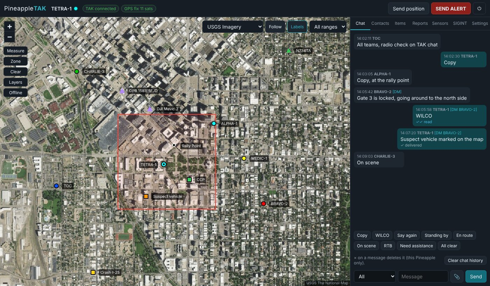
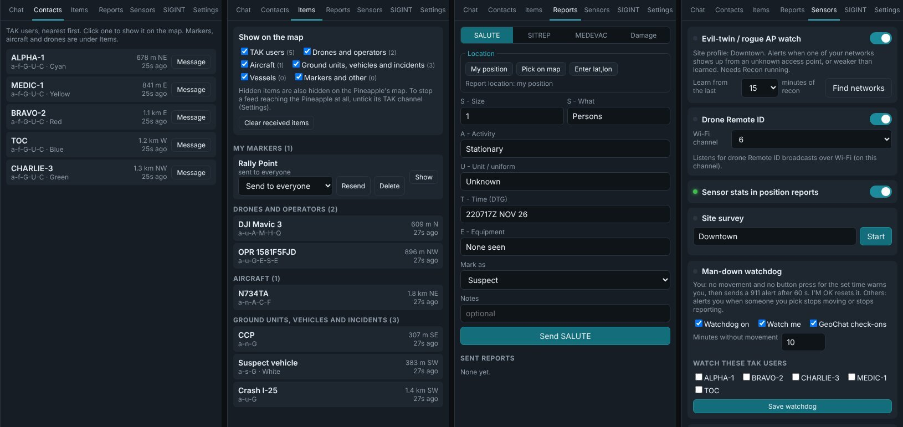
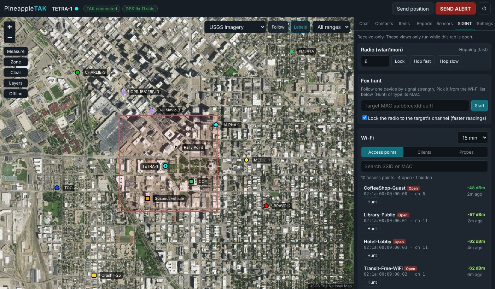
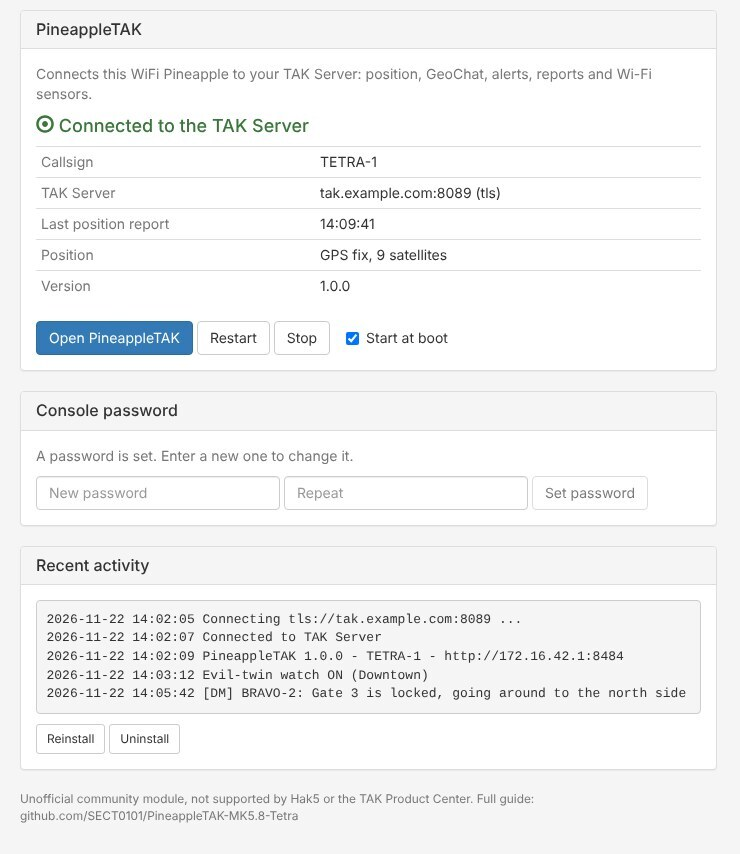

# PineappleTAK – TAK for the [WiFi Pineapple Tetra](https://docs.hak5.org/wifi-pineapple-6th-gen-nano-tetra)

<p align="center"></p>

[](https://www.buymeacoffee.com/sect0101)

A **Pineapple module** that connects the **Hak5 WiFi Pineapple Tetra** to your **TAK Server**, so it shows up on ATAK, WinTAK, iTAK, WebTAK and CloudTAK like any other team member. It sends its position, does GeoChat, alerts and reports, and turns the Pineapple's radios into TAK sensors.

PineappleTAK for the Tetra is the 6th-generation edition of [PineappleTAK for the Mark VII](https://github.com/SECT0101/PineappleTAK-MK7) and [PagerTAK](https://github.com/SECT0101/PagerTAK), and runs the same engine and web console. **It is a community module and is not supported or guaranteed by Hak5.** See [Legal](#legal).



---

## What it does

- **Position** from a USB GPS (u-blox and other NMEA receivers) or a position you set on the map. Sent as CoT, with the Pineapple's recon stats in the remarks if you want them.
- **GeoChat** with All Chat Rooms and direct messages, quick messages, and *delivered* / *read* receipts.
- **Alerts**: 911, Ring The Bell, Geo-fence Breached, Troops In Contact or a custom alert, to everyone or chosen contacts.
- **Reports**: SALUTE, SITREP, MEDEVAC 9-line and damage reports.
- **Sensors**, all receive-only:
  - Evil-twin / rogue AP watch: learn your site's networks from recon, then get an alert when one of them shows up from an unknown access point or with weaker security.
  - Drone Remote ID over Wi-Fi, with drones and operators on the map.
  - Site survey, packaged and uploaded to TAK.
  - Geofences and a man-down watchdog.
- **SIGINT tab**: radio control, fox hunt, and access point, client and probe tables from PineAP recon.
- **Map tools**: markers, zones, measure, TAK channels, offline maps, KML / KMZ overlays and file sharing.
- **Setup in the browser**: TAK Server certificate enrollment with your TAK username and password, ATAK connection package import, or .p12 / PEM upload.

The Tetra has **no Bluetooth features**: loading its Bluetooth driver restarts the Tetra, so the tracker watch and Bluetooth Remote ID are left out. Use [PineappleTAK for the Mark VII](https://github.com/SECT0101/PineappleTAK-MK7) for those.

## Screenshots

The web console runs on the Pineapple and opens in any browser on your laptop or phone. These shots use made-up demo data.





The module page in the Pineapple's web interface (shown here outside the Pineapple's page frame):

<p align="center"></p>

## Install

You need a WiFi Pineapple Tetra on firmware 2.7.0, with internet access for the first install.

1. Download `Pineapple-TetraTAK-<version>.tar.gz` from [Releases](../../releases).
2. Copy it to the Pineapple and unpack it into the modules folder:
   ```bash
   scp Pineapple-TetraTAK-1.0.1.tar.gz root@172.16.42.1:/tmp/
   ssh root@172.16.42.1 'tar xzf /tmp/Pineapple-TetraTAK-1.0.1.tar.gz -C /pineapple/modules/'
   ```
3. Reload the Pineapple's web interface (`http://172.16.42.1:1471`) and open **Modules > PineappleTAK**.
4. Press **Install**. It adds what is missing (`python3-light`, `python3-sqlite3`, `python3-openssl`, `ca-bundle`) and sets up the PineappleTAK service. This takes a few minutes.
5. Set a console password, press **Start**, then **Open PineappleTAK**. The console answers on port 8484 at the Pineapple's host name, its IP on your network and `http://172.16.42.1:8484`. *Console access* on the module page can limit it to the USB address or USB + VPN.
6. Set up the TAK Server connection in the console: enroll with your TAK username and password, import an ATAK connection package, or upload certificates.

Turn on **Start at boot** on the module page to have PineappleTAK connect every time the Pineapple starts.

### Internet for the Tetra

PineappleTAK needs a route to your TAK Server. Wi-Fi client mode uses the radio that PineAP and recon listen with, so with client mode the sensors and SIGINT tab have nothing to work with. For both, use one of these:

- **Ethernet**: the RJ45 port is the Tetra's internet (WAN) side and gets an address from your network.
- **Internet sharing** from your computer over the USB ETH port.
- **An extra USB Wi-Fi adapter** for client mode.

If the Tetra uses Ethernet and a Wi-Fi client on the same network, give each its own priority so both routes are kept and Ethernet comes first. Otherwise the Tetra can lose its internet route when Wi-Fi drops:

```bash
uci set network.wan.metric='10'
uci set network.wwan.metric='20'
uci commit network && /etc/init.d/network reload
```

The console listens on every network the Tetra is on, so you can open it from the network on the Ethernet port by the Tetra's host name or IP. Anyone on those networks can reach the console's sign-in page. To close it to them, set *Console access* on the module page (or *Settings > Web console access* in the console) to **USB address only** or **USB + VPN**.

**Optional hardware**
- A USB GPS for live position. Without one, set your position with *Pick on map* in the console.

**Updating:** unpack the new version over the old one and press **Reinstall** on the module page. Your settings, certificates, markers, zones and site profiles are kept. See the [changelog](CHANGELOG.md).

## Repository layout

```
pineappletak/            # the service that runs on the Pineapple (/root/pineappletak)
├── pineappletak.sh      # starts the engine, sensors and web console without a screen
├── tetra/               # Tetra layer: LED, USB GPS, PineAP recon and probe log, settings store
└── core/                # PagerTAK's engine, sensors and web console (shared with PagerTAK)
module/PineappleTAK/     # the Pineapple module (module.html, js/module.js, api/module.php, install.sh)
tools/build-module.sh    # builds Pineapple-TetraTAK-<version>.tar.gz
docs/                    # logo and screenshots
```

To build the package yourself, run `tools/build-module.sh` from the repository root.

## Contributing

- Use placeholders (`tak.example.com`) for hostnames, keys and passwords. Never commit certificates.
- Changes to `pineappletak/core` belong in [PagerTAK](https://github.com/SECT0101/PagerTAK) too, so all devices stay in step.
- Test on a Tetra before opening a PR. CI runs ShellCheck on the service scripts and syntax-checks the PHP, Python and JavaScript.

## Legal

Use PineappleTAK only on systems and networks you own or are authorized to use.
WiFi Pineapple is a trademark of Hak5 LLC. This project is not affiliated with Hak5 or the TAK Product Center.

Licensed under the [GNU GPL v3.0](LICENSE).
